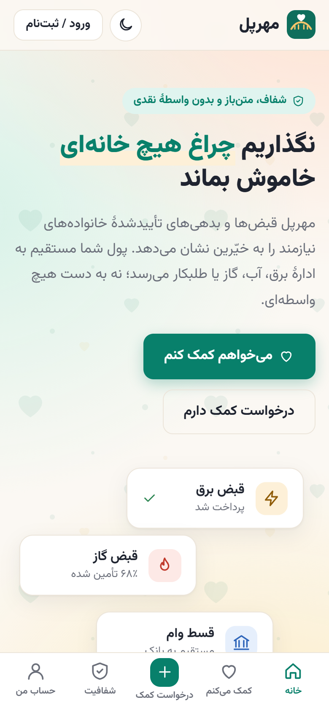
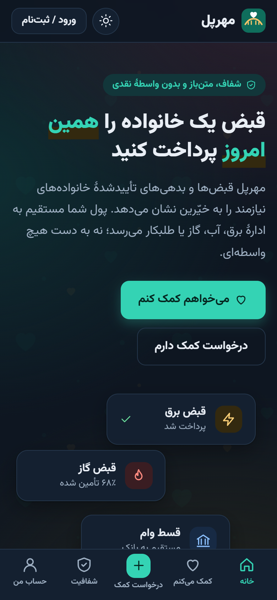
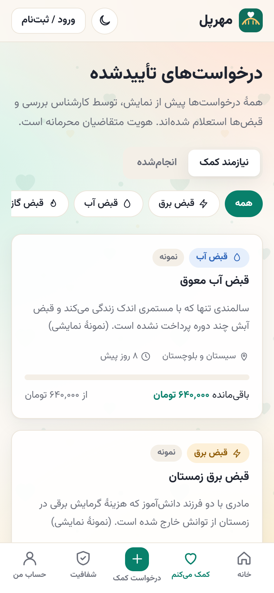
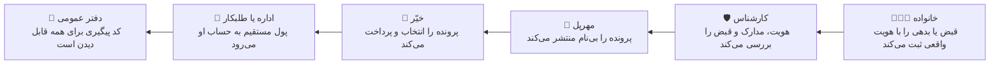
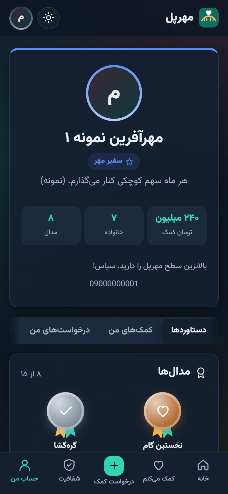
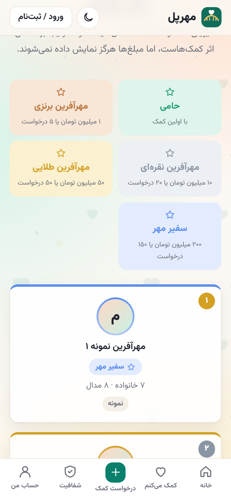
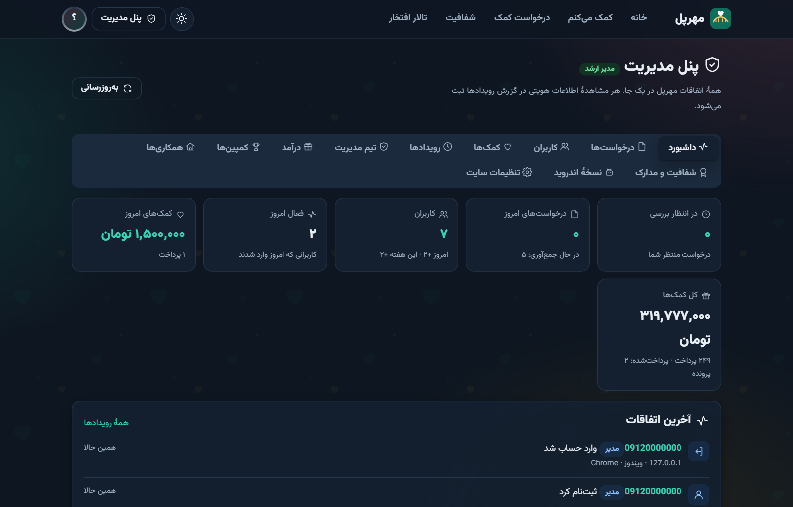

<div dir="rtl" align="center">


# مهرپل

### پلی میان دست‌های گشاده و نیازهای واقعی

قبض و بدهی خانواده‌های نیازمند، **مستقیم** به سازمان یا طلبکار پرداخت می‌شود؛<br>
نه پولی دست‌به‌دست می‌شود، نه هویتی فاش.


**ایده و ساخت: [علی جلایری](https://github.com/alijalayer)**

&nbsp;
&nbsp;


</div>

<div dir="rtl">

## چرا مهرپل؟

خیلی‌ها دوست دارند کمک کنند، اما یک سؤال ساده جلویشان را می‌گیرد: **«پولم به دست درست می‌رسد؟»**
از آن طرف، خانواده‌هایی هستند که قبض گاز زمستان یا قسط وامشان مانده و خجالت می‌کشند بگویند.

مهرپل این دو را به هم وصل می‌کند، بدون اینکه به هیچ‌کدام نیاز به اعتماد کورکورانه باشد:



## برای هر کس، چیزی

| | |
|---|---|
| 💚 **خیّرین** | مرور پرونده‌ها بر اساس نوع و استان، پرداخت کامل یا بخشی، رسید با کد پیگیری بانک، کمک ناشناس |
| 👨‍👩‍👧 **خانواده‌ها** | ورود با کد پیامکی، ثبت قبض با بررسی لحظه‌ای شناسه، بارگذاری مدارک همان موقع ثبت، پیگیری مرحله‌به‌مرحله |
| 🏅 **انگیزه** | پنج سطح از «حامی» تا «سفیر مهر»، ۱۵ مدال، امتیازهای ویژه، گواهی قدردانی قابل چاپ و قابل استعلام، تالار افتخار |
| 🔎 **شفافیت** | دفتر عمومی پرداخت‌ها، نمادها و مجوزها، مدارک رسمی، آمار زنده، کد کاملاً متن‌باز |
| 🌗 **ظاهر** | فارسی و راست‌به‌چپ، موبایل‌محور، حالت روز و شب، بدون وابستگی به CDN خارجی (مناسب اینترنت ایران) |
| 📱 **همه‌جا** | اپ اندروید با به‌روزرسانی از داخل برنامه، وب‌اپ آیفون (افزودن به صفحهٔ اصلی) |

<div align="center">
&nbsp;

</div>

## پنل مدیریت

همهٔ اتفاقات مهرپل در یک جا، با به‌روزرسانی خودکار:

- **داشبورد زنده:** درخواست‌های منتظر، کاربران جدید، کمک‌های امروز و آخرین اتفاقات (ثبت‌نام، ورود، درخواست، پرداخت)
- **درخواست‌ها:** هر پرونده با نام و شمارهٔ متقاضی، مدارک رمزنگاری‌شده، تأیید یا رد با دلیل، تخصیص از صندوق عمومی
- **کاربران:** مشخصات، زمان عضویت و آخرین ورود، همهٔ درخواست‌ها و کمک‌های هر نفر
- **رویدادها:** گزارش کامل ممیزی، از جمله اینکه کدام مدیر کِی اطلاعات چه کسی را دیده است
- **شفافیت و مدارک:** بارگذاری نماد اعتماد، مجوزها و مدارک رسمی، بدون دست زدن به کد
- **نسخهٔ اندروید:** انتشار APK جدید؛ اپ‌های نصب‌شده خودشان خبر می‌دهند و با یک لمس روی نسخهٔ قبلی نصب می‌شوند

<div align="center">

</div>

## امنیت، بدون تعارف

جزئیات کامل در [SECURITY.md](SECURITY.md).

- 🔐 نام، کد ملی، اطلاعات طلبکار و **فایل مدارک** با AES-256-GCM رمزنگاری می‌شوند
- 🔑 ورود بدون رمز عبور؛ کدها هش‌شده ذخیره و پس از ۵ تلاش اشتباه باطل می‌شوند
- 🧱 محافظت در برابر CSRF، XSS (CSP سخت‌گیرانه، بدون innerHTML برای داده‌ها)، کلیک‌جکینگ و حدس شناسه‌ها
- 🧪 نوع هر فایل از روی محتوایش تشخیص داده می‌شود، نه پسوند
- 🏦 تأیید پرداخت همیشه مستقیم از درگاه گرفته می‌شود؛ جعل پاسخ بازگشت بی‌اثر است
- 🚫 برنامه با تنظیمات ناامن (درگاه آزمایشی، کلید پیش‌فرض و…) در حالت production **اجرا نمی‌شود**

## اجرا

نیازمند Node.js نسخهٔ ۲۲.۱۳ یا جدیدتر.

```bash
npm install
cp .env.example .env        # در ویندوز: copy .env.example .env
npm run seed:demo           # اختیاری: پرونده‌های نمونه برای ارائه
npm start                   # http://localhost:3000
npm test                    # ۲۷ آزمون خودکار
```

در حالت نمایشی (`DEMO_MODE=true`) کد ورود روی صفحه نمایش داده می‌شود و پرداخت‌ها شبیه‌سازی می‌شوند. شماره‌ای که در `ADMIN_PHONES` قرار دهید، به پنل مدیریت دسترسی دارد. اتصال درگاه پرداخت، پنل پیامک و API پرداخت قبض: [docs/INTEGRATIONS.md](docs/INTEGRATIONS.md) · انتشار: [docs/LAUNCH.md](docs/LAUNCH.md)

## ساختار

```
server/src/         سرور (Fastify + SQLite داخلی Node)
  routes/           API عمومی، ورود، متقاضی، پرداخت، پنل مدیریت
  providers/        آداپتورهای پیامک، درگاه پرداخت، پرداخت قبض
  bill.js           اعتبارسنجی شناسهٔ قبض و پرداخت (ارقام کنترلی)
  security.js       رمزنگاری، هش، اعتبارسنجی کد ملی و موبایل
server/test/        آزمون‌های امنیتی و جریان کامل
public/             رابط کاربری (بدون فریم‌ورک و بدون build)
android/            پوستهٔ اپ اندروید (Capacitor)
config/             محتوای پیش‌فرض شفافیت و امتیازها
```

## مجوز

[MIT](LICENSE) — فونت وزیرمتن تحت مجوز [OFL](public/fonts/OFL.txt).

<div align="center">

ساخته‌شده با 💚 برای خانواده‌هایی که چراغ خانه‌شان نباید خاموش بماند.

</div>

</div>
